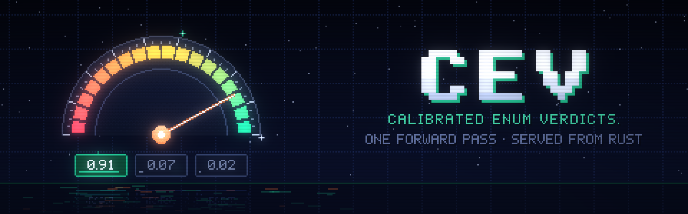

# cev

**Calibrated Enum Verdicts.** Typed, calibrated decisions in one forward pass, served from Rust. It learns from feedback while it runs.

cev is a from-scratch Rust take on TypeSafe's [Jev / System One](https://typesafe.ai/blog/introducing-system-one-models-and-jev) models. You send program state plus typed questions. You get back typed answers with probabilities, and the model never generates text.

- **noul** asks "is this true?" and returns a probability.
- **choice** asks "which of these?" and returns an option plus a distribution.
- **score** asks "which level?" and returns the expected level plus a distribution.

The wire format is compatible with `POST /v1/systemone`, so existing Jev SDKs work. cev runs its own zero-shot readout on any Qwen3 / Qwen3.5 checkpoint, and it runs the open decision models natively, with their own prompts and readout heads, weights pulled from Hugging Face (see [Models](#models)): Bespoke **Nimble**, Jared Palmer's **Kev**, the vLLM Semantic Router's **d3**, and Liquid's **d1** and **d1-omni**, including their image and audio inputs. On top of that, cev adds:

- **A decision log.** Every answer has a `decision_id` and is stored with its full context: the state, the question, the exact prompt text, the logits, and what was served.
- **Feedback.** Labels are attached by id and can always be exported as training data.
- **Online learning.** A per-task adapter learns from labels as they arrive, in Rust, without retraining the backbone.
- **A typed Rust SDK.** `#[derive(cev::Choice)]` on an enum turns a model decision into a `match`.

## How it works

```text
state ─┐
       ├─ compile ─▶ "<system> <evidence>{state}</evidence>"   shared prefix (LRU-cached)
       │             "Question … Options: A. … B. …"            one suffix per question (+ rotated variants),
questions                                                        all packed into ONE block-masked pass
   + images / audio            │
            Qwen3 · Qwen3.5 · LFM2 (candle, Metal/CUDA/CPU)
                               │  next-token logits of the answer codes only ("A", "B", …, up to 255)
                               ▼
          z = debiased log-scores (rotations averaged, minus content-free "N/A" baseline)
          h = hidden state at the answer position
                               │
          per-task adapter:  z' = z·e^-τ + b + W·norm(h)     (only served once it wins prequentially)
                               ▼
               typed answer + probabilities + decision_id  ──▶  SQLite log
                                                                   ▲
                               /v1/feedback {decision_id, label} ──┘──▶ adapter update, /v1/export ──▶ PyTorch LoRA
```

- **Backbone.** Any Qwen3 or Qwen3.5 safetensors checkpoint (`Qwen/Qwen3-1.7B` is the default), or a directory produced by `training/train_lora.py`. There is no custom head. The answer is the LM's own next-token distribution restricted to one-token option codes, so zero-shot works on day one and an out-of-type answer is impossible. The code vocabulary is checked against the tokenizer at startup. The decision models below bring their own prompt and readout instead; the rest of the pipeline (log, feedback, adapters, export) is the same.
- **One pass per request.** Everything goes into a single forward pass under an additive mask:
  - the (uncached tail of the) state,
  - every question,
  - every debiasing variant.

  Each question sees the state and itself only, with positions restarting per question. That is exactly equivalent to asking each question alone. States longer than 512 tokens prefill their head in chunks first. Prefixes are LRU-cached across requests. On Metal, attention uses candle's fused SDPA kernel with native GQA. Models with recurrent layers (Qwen3.5's Gated DeltaNet, LFM2's short convolutions) cannot take a packed block mask, so there the state prefix runs once into a cached state (keys and values, recurrent matrices, conv tails) and every question runs as one row of a right-padded batch continuing from it, which is the same computation.
- **Parity.** In f32, cev matches HF transformers to |Δp| < 5e-5 on CPU and Metal (`training/parity.py`), and each decision model matches a PyTorch reference built from its published parts to |Δp| ≲ 1e-5 on text (see [Models](#models)).
- **Confidence.** Uses TypeSafe's definitions. For choice: `(p_max − 1/K)/(1 − 1/K)`. For score: `1 − E|level − mode|/(K−1)`.

## Models

`--model` takes a Hugging Face repo id, a local directory, or one of the short names below (the tags follow ollama.com). Weights are found in the Hugging Face cache or downloaded to `~/.cache/cev/models`; adapters pull their pinned base too.

| `--model` | Weights | Architecture | Answers come from | Takes | Context |
|---|---|---|---|---|---|
| `Qwen/Qwen3-*`, `Qwen/Qwen3.5-*` | any Qwen3 / Qwen3.5 checkpoint | Qwen3 dense; Qwen3.5 hybrid Gated DeltaNet + gated attention | cev's prompt, LM logits of one-token codes (zero-shot, debiased) | text, images (Qwen3.5) | model's |
| `nimble-v3` (`nimble-v3:9b`, `:27b`) | `bespokelabs/Bespoke-Nimble-9B-v3` LoRA on `Qwen/Qwen3.5-9B`, merged at load | Qwen3.5 | LM logits of code tokens over a JSON schema of all questions | text | 32k |
| `kev` (`kev:0.8b`, `:4b`, `:9b`) | `jaredpalmer/kev-*` LoRA + `head.pt` on `Qwen/Qwen3.5-*-Base`, merged at load | Qwen3.5 | pointer head: each option's `<\|box_end\|>` against the `<\|fim_suffix\|>` decision token, with the checkpoint's temperature | text | 64k state |
| `d3` (`d3:2b`, `:4b`, `:8b`, `:27b`) | `vllm-sr/d3-nano` / `d3-mini` / `d3-flash` / `d3` | Qwen3.5, attention run bidirectionally over the whole prompt | a 255-way `readout.safetensors` matrix at the last position | text, images (Qwen3.5 vision tower, up to 1.6 MP each) | package's |
| `d1` (`d1:2b`, `:3b`) | `LiquidAI/d1-3B` (LFM2.5-VL) | LFM2 short-conv + GQA hybrid, SigLIP2 NaFlex tower | LM logits of option codes / yes-no / digits, best of each spelling | text, images (512 px tiles + thumbnail) | 32k |
| `d1-omni` (`:600m`, `:2b`) | `LiquidAI/d1-omni-600M` | bidirectional LFM2.5 encoder trunk, decision head over `<\|mask\|>` markers, SigLIP2 and FastConformer encoders | the decision head, with per-type temperatures | text, images, audio (16 kHz mono WAV, 30 s) | 16k; 896 text tokens with images |

What is checked (`cargo test --release -p cev-model --test parity_models --test parity_vision`, with the reference files from `training/parity/dump_*.py`): the largest difference in any option's probability over the same requests, against f32 PyTorch.

| Model | Reference | Text | Images | Audio | Metal f32 | Metal bf16 |
|---|---|---:|---:|---:|---:|---:|
| Qwen3.5-0.8B decoder | HF transformers hidden states and logits | rel. err 5e-6 (1095-token prompt, prefix state, padded rows) | | | | |
| `kev:0.8b` | PEFT merge + the pointer head from `head.pt` | 3e-6 | | | 2e-6 | 9e-3 |
| `nimble-v3` (9B) | PEFT merge on `Qwen3.5-9B` + Nimble's schema prompt | 3e-6 | | | 3e-6 | 4e-3 |
| `d3:2b` | Qwen3.5 with d3's bidirectional attention + `readout.safetensors` | 4e-6 | 5e-6 | | 1e-5 | 5e-3; image 2.3e-2 |
| `d1:3b` | HF `Lfm2VlForConditionalGeneration` + d1's prompt | 2e-6 | 2e-7 | | 7e-6 | 5e-3 |
| `d1-omni` | the model's math re-stated over its weights | 2e-6 | 4e-6 | 2e-8 | 8e-6 | 2.5e-2 |

The first three result columns are f32 on the CPU. Image preprocessing reproduces the processors' 8-bit antialiased resizing (torchvision's) and tiling, so pictures match too. bf16 moves probabilities by up to about 0.01 on text and 0.025 on images: Qwen3.5's vision tower grows a few channels past 5,000, where bf16 resolves steps of 32, so tokens with small outputs drift. `--dtype f32` gives the exact numbers; `--dtype auto` picks bf16 on Metal for checkpoints over 4 GB, which includes `d3:2b` and the 9B models. Kev-27B (Qwen3.8) and d3's video input are not supported.

Latency on an M4 Max through the server, 3 questions, `--dtype auto` (`scripts/bench_models.sh metal <model>…`, which runs `scripts/bench.py`). "Cached" means the state was seen before. Token counts include each family's own prompt and, for cev's zero-shot readout, its debiasing variants.

| Model | short state: tokens, cached / uncached | long state (~2k-token history): tokens, cached / uncached |
|---|---:|---:|
| `Qwen/Qwen3-1.7B` (cev, f32) | 571 tok, 158 / 190 ms | 2648 tok, 213 / 1154 ms |
| `Qwen/Qwen3.5-0.8B` (cev, f32) | 598 tok, 425 / 516 ms | 2757 tok, 695 / 2018 ms |
| `kev:0.8b` (f32) | 111 tok, 82 / 129 ms | 2264 tok, 145 / 1266 ms |
| `nimble-v3` (9B, bf16) | 379 tok, 185 / 1031 ms | 2453 tok, 194 / 5329 ms |
| `d3:2b` (bf16) | 400 tok, 305 / 340 ms | 6382 tok, 3938 / 3904 ms |
| `d1:3b` (f32) | 155 tok, 104 / 143 ms | 2242 tok, 112 / 1138 ms |
| `d1-omni` (f32) | 229 tok, 35 / 39 ms | 6481 tok, 698 / 791 ms |

- The uncached long-state times of the hybrid models are dominated by the Gated DeltaNet prefill, a sequential scan over 64-token chunks written in plain candle ops. A fused Metal kernel for it is the obvious next speed-up.
- d3 and d1-omni attend bidirectionally, so each question is a full row over the whole state and nothing is cached; their cost grows with questions × state length.

Notes per family:

- **Debiasing** (below) defaults to `full` for cev's own zero-shot readout and `none` for the trained decision models (`--debias auto`). Nimble's prompt lists every question's options in one schema, so option rotation is refused for it; `calibrate` works.
- **Prefix caching** applies to the causal models. d3 runs its attention bidirectionally over the whole prompt, so each question is one full row and nothing is cached between requests. d1-omni's trunk is bidirectional too.
- **Images** go through each family's own processor rules: Qwen3.5 `smart_resize` to multiples of 32 within 65,536 to 1,638,400 pixels; LFM2-VL's 512 px tiles (2 to 10) plus a thumbnail, 64 to 256 tokens per crop. d1-omni's image questions use the plain softmax, as in its reference code.
- **Audio** (d1-omni) is one WAV clip; other sample rates and stereo are resampled and mixed down. A request carries images or audio, not both.
- **Export** rows carry the exact prompt each family saw (`prefix` + `suffix`), so `/v1/export` still trains the right template; `codes` is empty for the pointer and marker readouts.

### Debiasing

Small instruct models have a strong option-position bias. Zero-shot Qwen3-1.7B picks "A" on 28 of 30 severity tickets. cev corrects this at inference time with two standard methods, set by `--debias` or per request with `"debias"`:

- **`calibrate`: contextual calibration.** cev subtracts the log-probabilities the model gives the same question over content-free evidence ("N/A"). Those logits don't depend on the state, so they are cached per question and are free after the first request with a given question set.
- **`permute`: rotation averaging.** cev averages over up to `--max-permutations` (default 4) cyclic rotations of the option order. The rotations are packed into the same pass.
- **`full`** applies both. **`none`** returns the raw distribution. **`auto`** (the default) is `full` for cev's own zero-shot readout and `none` for the trained decision models.

Zero-shot accuracy on small built-in tasks (`scripts/eval_zero_shot.py`):

| Qwen3-1.7B | severity (30) | "is the user blocked?" (30) | routing (12) |
|---|---:|---:|---:|
| none | 0.40 | 0.70 | 0.67 |
| calibrate | 0.77 | 0.80 | 0.92 |
| full | **0.80** | **0.97** | **0.92** |

Debiasing matters as much for calibration as for accuracy. Over the same 72 answers (42 items in `eval/items.jsonl`), pooled, with expected calibration error (ECE) over 15 equal-width bins on the top probability:

| | log loss | Brier | ECE |
|---|---:|---:|---:|
| Qwen3-1.7B, none | 6.871 | 0.846 | 0.424 |
| Qwen3-1.7B, calibrate | 0.685 | 0.315 | 0.147 |
| Qwen3-1.7B, full | **0.291** | **0.173** | **0.052** |
| Qwen3-0.6B, none | 1.741 | 0.650 | 0.244 |
| Qwen3-0.6B, full | **0.508** | **0.304** | **0.099** |

That is a small set, so read it as direction, not a benchmark. `scripts/eval_zero_shot.py` prints these against a running server. `cargo test --release -p cev-server --test zero_shot -- --ignored --nocapture` prints the same numbers in-process, and `CEV_EVAL_MODEL` picks the model.

### Online learning

The backbone stays frozen. Each task gets a residual layer, keyed by `task`, which is either given explicitly or derived from the type, instructions, and option names:

```text
z'_k = z_k · e^{-τ} + b_k + w_k · x,     x = standardize(h)/√d
```

- `τ` learns calibration.
- `b` learns label priors.
- `w` is a linear probe on the backbone's own representation of the question.

At zero, the layer is exactly the base model. After each label, cev refits over a replay buffer of recent labels (SGD warm start). It serves the adapter only once it beats the base model prequentially. That means every label is scored by both the base model and the adapter *before* either learns from it, so the comparison is always on unseen data. `GET /v1/tasks` shows both log losses and both Brier scores.

"Beats" is a significance test, not a comparison of two averages. cev keeps the last 64 per-label loss gaps (adapter minus base) and serves the adapter once their mean is below minus `--gate-z` standard errors (default 0.8), after at least `--min-examples` labels. On labels that carry no signal, the old rule of comparing two decayed averages switched a useless adapter on 35% of the time after 8 labels and about 20% after 16 to 64. Measured at `--gate-z 1`, the test brings that to 14% after 8 and 1–5% after 16 or more, and on a real signal it switches on after about 22 labels instead of 11. The default of 0.8 sits between that and `--gate-z 0`; its rates were not measured separately. `--gate-z 0` serves any adapter that is ahead on average.

#### Namespaces

Set `namespace` on a request (for example a customer, tenant, or experiment arm) to give its feedback its own bucket. Adapters are keyed by namespace *and* task. Labels on a decision made in `"acme"` only train and change answers for `"acme"`. Requests without a namespace use the default bucket, which never sees namespaced labels. Every namespace starts from the base model, and its adapter is only served once it wins on that namespace's own labels.

```json
{"state": "…", "namespace": "acme", "questions": {"team": {"type": "choice", "task": "router", "…": "…"}}}
```

Feedback needs no namespace: it applies to the decision's own. The answer's `x_cev.namespace` and the feedback response echo it back.

Measured with a 3-level severity scale (`scripts/demo_online.py`):

- **Raw Qwen3-0.6B** (`--debias none`). 21 labels raised held-out accuracy from 0.33 to 0.89. The adapter learned T = 2.47, so the raw model was overconfident.
- **Offline LoRA fine-tune.** The same 21 labels (`training/train_lora.py`), served back through cev, reached 1.00.
- **Debiased Qwen3-1.7B.** The base model was already at 0.89, and the adapter correctly stayed inactive because it did not beat the base prequentially (0.528 vs 0.509 loss). The gate prevents regressions.
- **Debiased Qwen3-0.6B, gate sensitivity.** After 21 labels the adapter was slightly ahead (loss 0.78 vs 0.83) but not by more than the noise. At `--gate-z 1` or the default 0.8 it stayed off and held-out accuracy stayed at 0.67. At `--gate-z 0.5` or `0` it was served and held-out accuracy reached 1.00. Use a lower `--gate-z` when labels are scarce and a wrong adapter is cheap, and keep the default when it is not.

The held-out set is only 9 tickets from the same distribution, so treat these as tests of the loop, not benchmarks.

#### Moving adapters

An adapter is small (tens of kilobytes) and can be exported and imported as NDJSON:

```bash
cev --db cev.db --export-adapters adapters.ndjson          # every adapter, every model; "-" is stdout
cev --db other.db --model Qwen/Qwen3-1.7B --import-adapters adapters.ndjson
```

Import loads the model, saves the adapters under its id, and exits. A file that mixes several source models needs `--import-from <model id>`, and tasks that already have an adapter are kept unless you pass `--import-overwrite`. Imported adapters start with no evidence: they are not served until they beat the base model on labels received in the new database, so a pack from elsewhere can't make answers worse. The temperature and per-option biases depend only on the option logits and names, so they carry to any backbone. The probe weights carry only to the same hidden size, and are restarted otherwise. This is also how to keep adapters across a new fine-tuned checkpoint, which has a different model id.

### Offline training (PyTorch)

Online adapters are cheap and immediate. For bigger shifts, fine-tune the backbone on the log:

```bash
cd training && uv sync
uv run python train_lora.py --base Qwen/Qwen3-1.7B --source http://127.0.0.1:8080 --out ./ckpt/v1
cev --model ./ckpt/v1
```

`/v1/export` returns one row per labelled decision. Each row has the exact served `prompt`, the answer `codes`, the `target` distribution, and the weight, comment, and metadata. That keeps training byte-identical to serving. The trainer applies soft cross-entropy on the code logits only (LoRA r=16), holds out a deterministic 10% of rows for before/after evaluation, merges the adapter, and writes safetensors that cev loads directly.

`/v1/export?labeled=false` also returns unlabelled decisions, for example to label them offline with a bigger teacher model.

## Run

```bash
cargo run --release -p cev-server --features metal -- --model Qwen/Qwen3-1.7B   # macOS, cev's zero-shot readout
cargo run --release -p cev-server --features metal -- --model kev:4b           # Kev on Qwen3.5-4B-Base
cargo run --release -p cev-server --features metal -- --model d1               # Liquid d1-3B, text and images
cargo run --release -p cev-server --features metal -- --model d1-omni          # text, images and audio
cargo run --release -p cev-server --features cuda  -- --model d3:8b
cargo run --release -p cev-server -- --mock        # no model; keyword stub for wiring tests
```

From crates.io, `cargo install cev-server --features metal` (or `cuda`) installs the same binary as `cev`.

Weights come from a local directory or the Hugging Face cache (`hf download`), or are downloaded into `~/.cache/cev/models` (`HF_TOKEN` is used when set). The `--dtype auto` default picks f32 on CPU, and on Metal for checkpoints up to 4 GB; otherwise it picks bf16. `GET /v1/models` reports the family and modalities that were loaded.

Other flags:

| Flag | Default | Purpose |
|---|---|---|
| `--db` | `cev.db` | SQLite file for the decision log |
| `--addr` | `127.0.0.1:8080` | Listen address |
| `--api-key` | none | Require a bearer token on `/v1/*` and `/graphql` |
| `--allowed-host` | loopback names on a loopback `--addr`, else any | Host names the server answers to (repeat, or comma-separate `CEV_ALLOWED_HOSTS`; `*` for any). Stops DNS-rebinding pages from reading the API |
| `--web` | none | Serve the browser page from this directory (`web/`) at `/`; the page sends no token, so it needs a server without `--api-key` |
| `--no-online-learning` | off | Only store labels; don't adapt |
| `--no-store-features` | off | Don't store hidden states (they are stored as half floats) |
| `--min-examples` | 8 | Labels needed before an adapter can be served |
| `--gate-z` | 0.8 | Standard errors an adapter must lead the base model by to be served |
| `--export-adapters` | none | Write every stored adapter as NDJSON to a file (`-` for stdout) and exit |
| `--import-adapters` | none | Load adapters from such a file into the loaded model and exit |
| `--import-from` | none | With import: only adapters fit on this model id |
| `--import-overwrite` | off | With import: replace adapters that already exist |
| `--debias` | `auto` | Debias mode: `auto`, `none`, `calibrate`, `permute` or `full` |

Each flag has a matching `CEV_*` environment variable.

Latency on an M-series Mac, f32, 3 questions, end to end over HTTP (`scripts/bench.py`). "Cached" means the state prefix was seen before.

| model | debias | short state (~270 tok): cached / uncached | long state (~2.3k tok): cached / uncached |
|---|---|---:|---:|
| Qwen3-0.6B | none, calibrate | 35 / 49 ms | 59 / 439 ms |
| Qwen3-0.6B | full | 78 / 91 ms | 129 / 510 ms |
| Qwen3-1.7B | none, calibrate | 70 / 100 ms | 93 / 831 ms |
| Qwen3-1.7B | full | 158 / 193 ms | 212 / 1000 ms |

### In the browser

`web/` is a page for trying cev by hand: pick a model, ask typed questions about text, an image or a voicemail, run them continuously over a microphone, camera, screen or media file, click the right answer to send a label, and watch the adapter take over. Decisions run in one of two places:

- **On a local cev server**, which serves the page itself. This is the fast one: the model runs natively on the GPU, and the page only captures, uploads and plays media.

  ```bash
  cargo run --release -p cev-server --features metal -- --model d1-omni --web web    # then open http://localhost:8080
  ```

- **In the tab**, with no server: `crates/cev-wasm` compiles the engines, the runtime and the online learner to WebAssembly, and nothing leaves the tab.

  ```bash
  scripts/build_web.sh && python3 -m http.server -d web 8787    # then open http://localhost:8787
  ```

The page shows "On the cev server" when a server serves it, and still offers "In this tab" (after `scripts/build_web.sh`). On the server the model is the one `--model` picked; in the tab it is one of these:

| model | download | wasm memory | takes |
|---|---:|---:|---|
| Qwen3-0.6B (cev readout) | 1.5 GB | 2.9 GB | text |
| Kev-0.8B | 1.6 GB | about 2.6 GB | text |
| d1-omni-600M | 2.3 GB | about 2.5 GB | text, images, audio (WAV) |

- The page starts on the mock backend. Loading a model streams its safetensors into the wasm module, converting each tensor to f32 as it arrives. Each repository's files come from `web/models/<repo name>/` if that exists (a symlink to a Hugging Face snapshot directory works: `Qwen3-0.6B`, `kev-0.8b` plus `Qwen3.5-0.8B-Base`, `d1-omni-600M`), otherwise from huggingface.co at a pinned revision, cached in the browser afterwards.
- Kev's LoRA adapter is merged in the browser. Its base checkpoint's vision tower and multi-token-prediction block are skipped as they stream past, and the 248k-row embedding table stays bf16: that is what fits it in the 4 GB a wasm32 module can address. Larger models (d1-3B, d3, Nimble) do not fit.
- "Screenshot check" and "Voicemail" attach the files in `web/examples/`; "Add image" and "Add WAV" attach your own. Media are sent as data URLs, as on the REST API.
- Answers are the same as the native CPU build (`tests/memory_load.rs` checks the in-memory load path against loading from disk; in the page, the examples match the native server to the printed digit).
- The decision log is in memory (SQLite is not built for wasm) and is gone on reload. "Export labels" downloads the same NDJSON as `/v1/export`.
- It is slow: one thread, f32. On an M4 Max, Kev answers the 3-question ticket (107 tokens) in about 12 s, and d1-omni the screenshot (554 tokens) in about 47 s and the voicemail (459 tokens) in about 26 s, against about 1 s natively on the CPU.

**Live.** The Live panel asks the request's questions over and over: every few seconds it sends the last few seconds of sound (as a WAV) or the current video frame (as a JPEG), one request at a time, skipping ticks that come while one is running. Sources are the microphone, a camera, a shared screen, or an audio or video file played in the page ("two voicemails" and "checkout screens" in `web/examples/`). Each question gets a strip of stacked bars, one per answer, so a change over time is visible. Ticks stay out of the decision log unless "keep in the decision log" is on (and only kept ticks can be labelled).

| d1-omni-600M, M4 Max | per answer |
|---|---:|
| server (Metal), 5 s of sound | 0.9 s |
| server (Metal), a frame | 0.17 s |
| in the tab, a frame | 12 s |

Microphones and cameras need a secure context: `localhost` counts, a LAN address does not. The server accepts request bodies up to 96 MB (GraphQL included), enough for 64 MB of media. A request carries at most 16 images (each at most 8192 px a side, aspect ratio at most 200), WAV audio at 4–192 kHz, and 4 MB of state and question text. Malformed media and prompts past the context limit get a 400. GraphQL takes only `Content-Type: application/json` POSTs, so a web page cannot submit mutations to a local server cross-site.

**int8.** `cev-model`'s `quantize` example writes an int8 copy of a checkpoint (per-row scales, inputs quantized to 13 bits at run time). It loads anywhere a model directory does (`cev --model <dir>`, CPU only), and the page offers it when it is in `web/models/`:

```bash
cargo run --release -p cev-model --example quantize -- Qwen/Qwen3-0.6B web/models/Qwen3-0.6B-q8
```

Single-threaded wasm on an M-series Mac, short state and 3 questions (`node scripts/bench_web.mjs <model dir>`, same V8 as Chrome):

| Qwen3-0.6B | file | wasm memory | calibrate: first / new state / same state | full: first / new state / same state |
|---|---:|---:|---:|---:|
| f32 | 1.5 GB | 2.9 GB | 10.6 / 5.2 / 3.3 s | 20.5 / 12.2 / 10.1 s |
| int8 | 0.75 GB | 1.3 GB | 10.1 / 5.0 / 3.2 s | 20.0 / 11.7 / 9.7 s |

int8 halves the download and memory but is not faster: 70–85% of the time is the matmul kernel either way, and 16-bit × 8-bit integer products cost about what f32 does in 128-bit SIMD. Against f32 on the built-in zero-shot tasks (`scripts/eval_zero_shot.py <int8 url> <f32 url>`), int8 picks the same answer on 69–71 of 72 questions depending on debias mode, with a mean probability difference of 0.015–0.04 and accuracy within a few points either way.

## API

### REST

| Method | Path | |
|---|---|---|
| POST | `/v1/systemone` | Jev-compatible decide. Extensions: `task` per question, `namespace`, `no_store`, `debias`, `images` (base64 or data URLs, every question sees them), `audio` (one base64 WAV); `request_id`, `latency_ms`, and `x_cev.decision_id` in the response |
| GET | `/v1/models` | Backbone, family, modalities, options per question, prompt version |
| POST | `/v1/feedback` | `{decision_id \| request_id+question_id, label?, weight?, comment?, metadata?}` |
| POST | `/v1/examples` | `{examples: [{state, questions, labels, namespace?}]}`: decide, then learn from the labels |
| GET | `/v1/decisions?task=&namespace=&limit=&offset=` | Recent decisions |
| GET | `/v1/decisions/{id}` | One decision with its state, exact prompt, and all feedback |
| GET | `/v1/tasks?namespace=`, `/v1/tasks/{task}?namespace=` | Adapter status: labels, temperature, prequential losses, active |
| DELETE | `/v1/tasks/{task}?namespace=` | Drop an adapter; its labels stay in the log |
| GET | `/v1/export?task=&namespace=&labeled=&since=&limit=` | NDJSON training rows |
| GET | `/v1/stats`, `/health` | Counts and liveness |

Labels:

| Question type | Accepted labels |
|---|---|
| noul | `true`/`false`, `"yes"`/`"no"`, or a probability |
| choice | The option name, or `{"option": p}` |
| score | A level index (fractional values split between neighbours), or `{"0": p, …}` |

```bash
curl -s localhost:8080/v1/systemone -H 'content-type: application/json' -d '{
  "state": {"ticket": "The app crashes when I tap Log in"},
  "questions": {
    "team": {"type": "choice", "instructions": "Which team?", "criteria": {"billing": "Payments", "tech": "Bugs and crashes"}},
    "refund": {"type": "noul", "instructions": "Is a refund requested?"},
    "severity": {"type": "score", "instructions": "How severe?", "criteria": ["Cosmetic", "Degraded", "Blocking"]}
  }}'
curl -s localhost:8080/v1/feedback -H 'content-type: application/json' \
  -d '{"decision_id": "dec_…", "label": 2, "comment": "user is fully blocked", "metadata": {"by": "agent-7"}}'
```

With a model that takes them, pictures and sound go in the same request; a question can be about the media alone:

```bash
curl -s localhost:8080/v1/systemone -H 'content-type: application/json' -d "{
  \"state\": \"Receipt photographed by the customer\",
  \"images\": [\"$(base64 -i receipt.jpg)\"],
  \"questions\": {\"total_over_100\": {\"type\": \"noul\", \"instructions\": \"Is the total above 100?\"}}}"
curl -s localhost:8080/v1/systemone -H 'content-type: application/json' -d "{
  \"state\": null, \"audio\": \"$(base64 -i clip.wav)\",
  \"questions\": {\"intent\": {\"type\": \"choice\", \"instructions\": \"What does the caller want?\",
                  \"criteria\": {\"refund\": null, \"support\": null, \"sales\": null}}}}"
```

### GraphQL

`POST /graphql` (GraphiQL UI at `GET /graphql`):

```graphql
mutation {
  decide(state: {ticket: "The app crashes on login"}, questions: [
    {id: "team", type: CHOICE, instructions: "Which team?", criteria: {billing: "Payments", tech: "Bugs"}, task: "router"}
    {id: "refund", type: NOUL, instructions: "Refund requested?"}
  ]) { requestId answers { questionId decisionId answer confidence probabilities { option probability } } }
}
mutation { feedback(decisionId: "dec_…", label: "tech", comment: "…") { learned taskExamples adapterActive } }
query { tasks { task examples active baseLoss adaptedLoss } decision(id: "dec_…") { state prompt feedback } }
```

## Typed decisions in Rust

`cargo add cev-rs`. The crate is published as `cev-rs` and imported as `cev`.

```rust
#[derive(cev::Choice, Debug, Clone, Copy, PartialEq)]
#[cev(instructions = "Which team should handle this ticket?", task = "router.team")]
enum Team {
    /// Payments, invoices, refunds
    Billing,
    /// Bugs, crashes, error messages
    Engineering,
    #[cev(rename = "sales", description = "Pricing and upgrades")]
    Sales,
}

let cev = cev::Cev::http("http://127.0.0.1:8080");      // or Cev::local(runtime) in-process
let acme = cev.clone().with_namespace("acme");            // feedback on acme's decisions only adapts acme

if *cev.check(&ticket, "Is the customer asking for a refund?").await? { /* … */ }

let team = cev.pick::<Team>(&ticket).await?;              // Decided<Team>, derefs to Team
match *team {
    Team::Billing => {}
    Team::Engineering => {}
    Team::Sales => {}
}
if team.confident(0.8).is_none() { /* route to a human */ }
team.correct(Team::Engineering).await?;                   // typed feedback via decision_id

// several questions, one forward pass
let mut q = cev.ask(&ticket);
let (t, s, r) = (q.choose::<Team>("Which team?"), q.score::<Severity>("How severe?"), q.check("Refund?"));
let a = q.send().await?;
let (team, severity, refund) = (a.get(t)?, a.get(s)?, a.get(r)?);

// pictures and sound (with a model that takes them)
let a = cev.ask(&"a receipt").image(&std::fs::read("receipt.jpg")?).send().await?;
```

How the derive maps an enum:

- Variant names become option names (snake_case, or overridden with `rename`).
- Doc comments become option descriptions.
- For scores, variant order is the level order.

A full in-process example: `cargo run --release -p cev-rs --features local,metal --example router -- Qwen/Qwen3-1.7B`.

## Layout

| Crate | |
|---|---|
| `cev-core` | Wire types, prompt compiler, answer math, label → target, the `Backend` trait and a mock |
| `cev-model` | candle backbones: Qwen3 (packed block-masked questions), Qwen3.5 (Gated DeltaNet + gated attention, vision tower), LFM2 / LFM2.5 (d1, d1-omni trunk), SigLIP2, FastConformer audio; the family readouts (codes, d3 matrix, Kev pointer head, d1 token groups, d1-omni decision head); LoRA merging; weight resolution and aliases |
| `cev-runtime` | The decision service: SQLite log (in-memory on wasm), feedback, online adapters, export |
| `cev-server` | `cev` binary: axum REST + async-graphql |
| `cev-wasm`, `web/` | Browser page: runs on the local server (`cev --web web`) or in the tab (the same pipeline as a wasm module in a web worker, in-memory log); live mic, camera, screen and file streams |
| `cev-rs`, `cev-derive` | Typed SDK, imported as `cev` (`http` and `local` transports) and `#[derive(Choice)]` |
| `training/` | PyTorch: `train_lora.py` (fine-tune from export), `parity.py` (check cev against transformers), `parity/dump_*.py` (reference answers for each decision model) |

Tests:

- `cargo test --workspace --features cev-rs/local` runs everything against the mock backend, with no weights needed.
- `training/parity.py` checks the real network against transformers.
- `training/parity/dump_{qwen35,qwen35_vision,kev,d3,d1,omni_ref,nimble}.py` write reference answers (the 9B Nimble run needs about 40 GB of RAM); `CEV_PARITY_<NAME>=<file> cargo test --release -p cev-model --test parity_models --test parity_vision -- --nocapture` compares cev to them (`CEV_PARITY_DEVICE=metal`, `CEV_PARITY_DTYPE=bf16` for the accelerator paths).
- `CEV_MEMORY_LOAD=1 cargo test --release -p cev-model --test memory_load` loads Kev and d1-omni the way the browser does (files in memory, weights streamed in chunks) and checks every logit against loading from disk.
- `cargo build -p cev-wasm --target wasm32-unknown-unknown` checks the browser build.

## Status / next

- Qwen3 dense, Qwen3.5 dense hybrids and LFM2 / LFM2.5. Next: a fused Metal/CUDA kernel for the Gated DeltaNet prefill, quantized (GGUF) weights, Qwen3-MoE, Qwen3.8 (Kev-27B), and d3's video input.
- An explicit "insufficient evidence" option, and building the attention mask on the GPU for very long states.
- Larger option sets through an embedding shortlist before scoring.
- Per-tenant isolation for adapters and logs.
